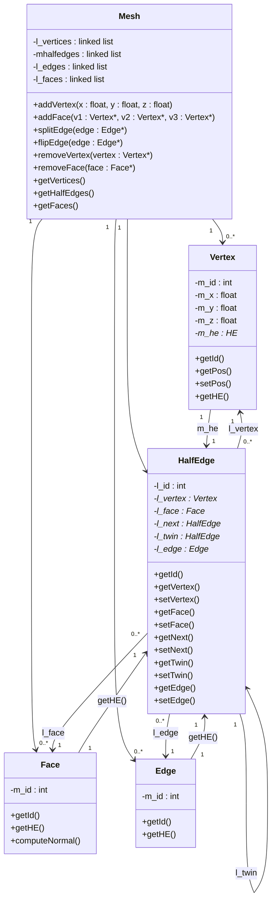

# Diagramme UML – Structure de maillage (Half-Edge)

Diagramme de classes d'une structure de maillage de type *half-edge* : `Mesh`, `HalfEdge`, `Vertex`, `Face`, `Edge`.

## Diagramme (Mermaid)

## Description des classes

### Mesh

Conteneur principal du maillage.

| Visibilité | Membre | Type |
|---|---|---|
| - | `l_vertices` | linked list |
| - | `mhalfedges` | linked list |
| - | `l_edges` | linked list |
| - | `l_faces` | linked list |

| Méthode | Paramètres |
|---|---|
| `addVertex` | `x : float, y : float, z : float` |
| `addFace` | `v1 : Vertex*, v2 : Vertex*, v3 : Vertex*` |
| `splitEdge` | `edge : Edge*` |
| `flipEdge` | `edge : Edge*` |
| `removeVertex` | `vertex : Vertex*` |
| `removeFace` | `face : Face*` |
| `getVertices` | – |
| `getHalfEdges` | – |
| `getFaces` | – |

### HalfEdge

Demi-arête orientée, élément central de la structure.

| Visibilité | Attribut | Type |
|---|---|---|
| - | `l_id` | int |
| - | `l_vertex` | Vertex* |
| - | `l_face` | Face* |
| - | `l_next` | HalfEdge* |
| - | `l_twin` | HalfEdge* |
| - | `l_edge` | Edge* |

Méthodes : `getId()`, `getVertex()` / `setVertex()`, `getFace()` / `setFace()`, `getNext()` / `setNext()`, `getTwin()` / `setTwin()`, `getEdge()` / `setEdge()`.

### Vertex

| Visibilité | Attribut | Type |
|---|---|---|
| - | `m_id` | int |
| - | `m_x` | float |
| - | `m_y` | float |
| - | `m_z` | float |
| - | `m_he` | HE* |

Méthodes : `getId()`, `getPos()`, `setPos()`, `getHE()`.

### Face

| Visibilité | Attribut | Type |
|---|---|---|
| - | `m_id` | int |

Méthodes : `getId()`, `getHE()`, `computeNormal()`.

### Edge

| Visibilité | Attribut | Type |
|---|---|---|
| - | `m_id` | int |

Méthodes : `getId()`, `getHE()`.

## Relations

| Source | Cardinalité | Cible | Cardinalité | Rôle |
|---|---|---|---|---|
| Mesh | 1 | Vertex | 0..* | contient les sommets |
| Mesh | 1 | HalfEdge | 0..* | contient les demi-arêtes |
| Mesh | 1 | Face | 0..* | contient les faces |
| Mesh | 1 | Edge | 0..* | contient les arêtes |
| HalfEdge | 0..* | Vertex | 1 | `l_vertex` |
| HalfEdge | 0..* | Face | 1 | `l_face` |
| HalfEdge | 0..* | Edge | 1 | `l_edge` |
| HalfEdge | 1 | HalfEdge | 1 | `l_next`, `l_twin` |
| Vertex / Face / Edge | 1 | HalfEdge | 1 | `m_he` / `getHE()` |

## Remarques sur le diagramme source

- Le diagramme original contient des textes « Texte » / « Saisissez du texte » (étiquettes de relations vides), ignorés ici.
- Les cardinalités des relations entre `HalfEdge`, `Vertex`, `Face` et `Edge` (`1`, `1`, `0..`, `1`) étaient partiellement illisibles ; elles ont été déduites de la logique half-edge.
- Le type `HE*` dans `Vertex` désigne vraisemblablement `HalfEdge*`.
- Les préfixes sont incohérents (`l_` et `m_`), et `mhalfedges` s'écrit sans underscore : ils ont été conservés tels quels.
